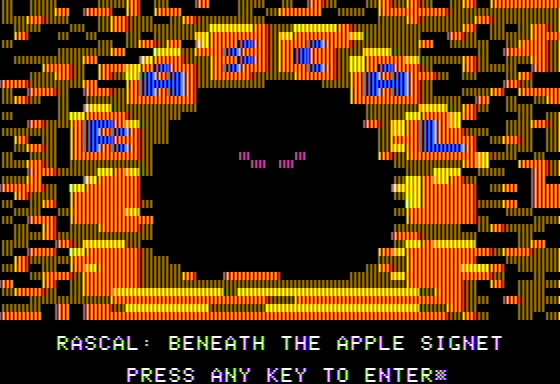
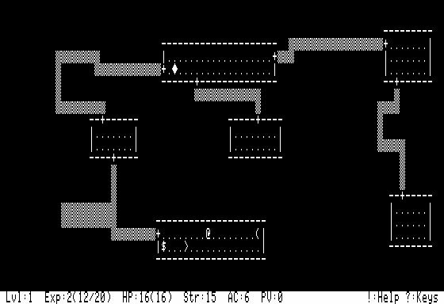
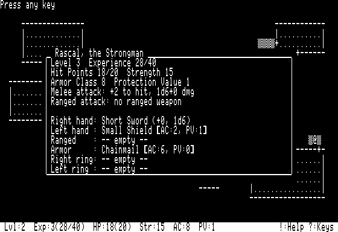

# Rascal

  
  
  

A roguelike game for the Apple IIe/IIc, heavily inspired by classic Rogue —
built from scratch, not a port. Written in C for the [cc65](https://cc65.github.io/)
cross-compiler, targeting the `apple2enh` platform.

Design, graphic and code by mcrstr (Fyodor Melnikov), additional code by Claude (Anthropic).

The instruction manual is attached to every release. See the [latest release](https://github.com/mcrstr/Rascal/releases/latest) for how to play.

## Building

A ready-to-run disk image is available on the Releases page. Build from source only if
you want to modify the game.

You'll need:

- [cc65](https://cc65.github.io/) V2.19 or newer (tested with V2.19, git 2ea1df8). The game
  is built to fit into a very tight memory budget, and older versions of the compiler
  generate larger code, which may not fit.
- Java (any recent JRE).
- [AppleCommander](https://applecommander.github.io/) 13.1, for writing files onto a ProDOS
  disk image.
- A ProDOS boot disk of your own, with `PRODOS` and `BASIC.SYSTEM` already on it, its **volume
  named exactly `RASCAL`** — the game hardcodes this name when it sets its working directory.
  A free, actively maintained ProDOS release is available at
  [prodos8.com](https://prodos8.com/).

`PRODOS` and `BASIC.SYSTEM` are not included in this repository — they're Apple's own files,
not part of this project's source, and not covered by its license.

### Steps

The build script is a Windows batch file. On Linux or macOS, run the same commands by hand:
they are listed in build.bat in the order they run.

1. Put all files from this repository in one folder, alongside AppleCommander-ac-13.1.jar
   and your ProDOS disk image.
2. Edit `build.bat` — set `YOURDISK` to the filename of your own ProDOS disk image.
3. Run `build.bat`. It compiles everything, links it, checks the memory map for overlay
   overflows, renames your disk's volume to `RASCAL`, and writes the game onto it —
   including a `STARTUP` launcher, so the disk boots straight into the game with no typing
   required.

The build targets ten separate 4K overlay slots plus a tight resident memory budget — this
is a genuinely memory-constrained 6502 program, not a modern one recompiled for old hardware.
If you extend the game and a slot overflows, `build.bat` will tell you which one.

## Architecture notes

Rascal's "resident" core (movement, combat, rendering, level generation) stays loaded at all
times. Everything else — inventory screens, shops, scrolls, and so on — lives in one of ten
overlay files loaded from disk on demand. On the disk, the main program is the file RASC,
and the overlays are RASC.1 to RASC.10. See the comments throughout the source for the
constraints this imposes (particularly around `static const` data inside overlay functions,
and which functions are safe to call from which overlay).

## License

GPL v2 (or, at your option, any later version). See `LICENSE`.

## Credits

- **[cc65](https://cc65.github.io/)** — free, open-source C compiler and assembler toolchain
  for 6502-family processors.
- **[AppleCommander](https://applecommander.github.io/)** — free, open-source tool for
  building and editing Apple II disk images.
- **ProDOS** and **BASIC.SYSTEM** — originally created by Apple Computer, Inc. The modern
  release used for testing this game is maintained by John Brooks and freely distributed by
  the Apple II community.

Apple, Apple II, and ProDOS are trademarks of Apple Inc. Rascal is an independent,
non-commercial fan project, not affiliated with or endorsed by Apple.
